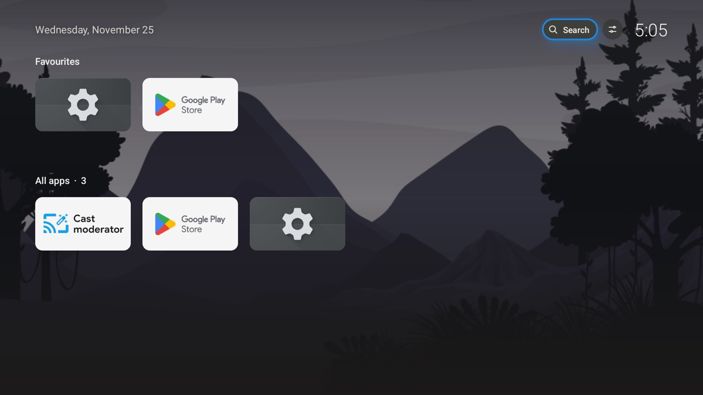
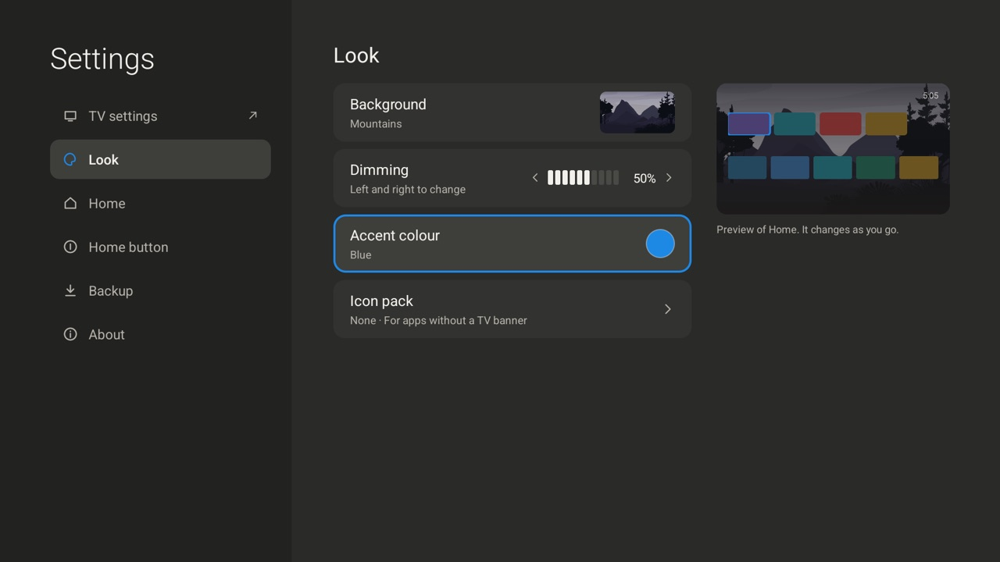

<p align="center"></p>

# Ember

A small, calm home screen for Android TV and Google TV, built for the remote. Your apps, your inputs, a clock.
No ads, no recommendations, no rows of shows you didn't ask for.

<p align="center"></p>

## What it does

- **Favourites, Inputs and All apps.** Apps show as 16:9 TV banners. An app without a banner gets a tile tinted from
  its own icon. The Inputs row shows the HDMI devices that are plugged in, such as a PlayStation, and switches to them
  in one press.
- **Hold OK on any app** to add it to Favourites, move it, rename it, hide it, open App info or uninstall it.
- **Search** fills the screen and forgives a slip on the remote's keyboard ("plya" finds Play Store). Open it with the
  Search key on the top bar or the Search button on your remote.
- **Settings** in two panes, with a live preview of Home:
  - **Look:** background picture (built-in, plain or your own), dimming, accent colour, icon pack.
  - **Home:** clock, apps per row, Inputs row, empty ports, hidden apps.
  - **Home button:** whether the Home button opens Ember (see below).
  - **Backup:** save and restore everything as one file. Most TVs have no file picker; then the backup goes to
    `Android/data/dev.ember/files/ember-backup.json`.
- **Private by design.** Ember has no internet permission, so it can't send anything anywhere.

<p align="center"></p>

## Remote keys

| Key | Does |
|---|---|
| Arrows | Move between apps and keys |
| OK | Open the app |
| Hold OK | App options: favourite, move, rename, hide, info, uninstall |
| Search | Search your apps |
| Left / Right on Dimming | Change the dimming in 10% steps |

## Install

Ember needs Android 8.0 or newer. There are no release builds yet, so build the APK first (below), then, with the TV
on [adb](https://developer.android.com/tools/adb):

```bash
adb install app/build/outputs/apk/debug/app-debug.apk
```

Make Ember the home app:

```bash
adb shell cmd role add-role-holder android.app.role.HOME dev.ember 0
```

**Google TV only:** Google TV opens its own home screen when you press Home, even when another home app is the
default. To make Home open Ember, turn on Ember's accessibility service in **Settings → System → Accessibility →
Ember**, or from a computer:

```bash
adb shell settings put secure enabled_accessibility_services dev.ember/dev.ember.HomeWatcher
```

The service only notices when the stock home screen opens, and brings Ember back. It reads nothing else. The command
above replaces any other accessibility services you have on, such as Projectivy's. Force-stopping Ember switches the
service off on some TVs; run the command again if Home starts opening Google TV.

### Going back to the stock home screen

Uninstall Ember from **Settings → Apps**, or:

```bash
adb uninstall dev.ember
```

## Build

You need JDK 17 or newer and the Android SDK.

```bash
JAVA_HOME=/path/to/jdk ./gradlew testDebugUnitTest assembleDebug
```

The APK lands in `app/build/outputs/apk/debug/`. Ember is plain Android Views in Kotlin, with no libraries beyond the
platform.

## Licence

MIT, see [LICENSE](LICENSE). The background picture is from [Dracula Theme](https://github.com/dracula/wallpaper),
also MIT, see [THIRD_PARTY_NOTICES.txt](THIRD_PARTY_NOTICES.txt).
